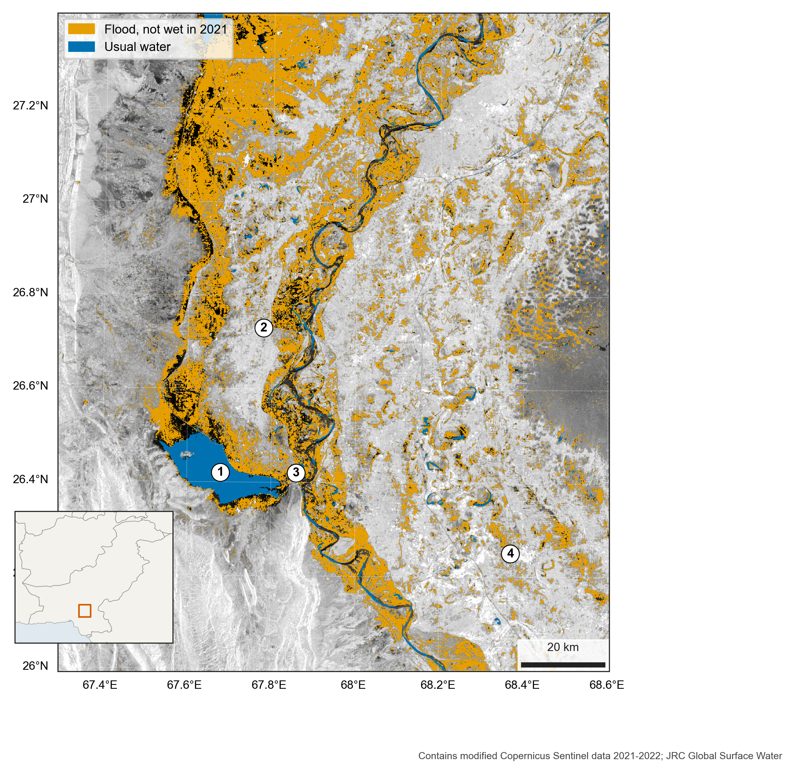
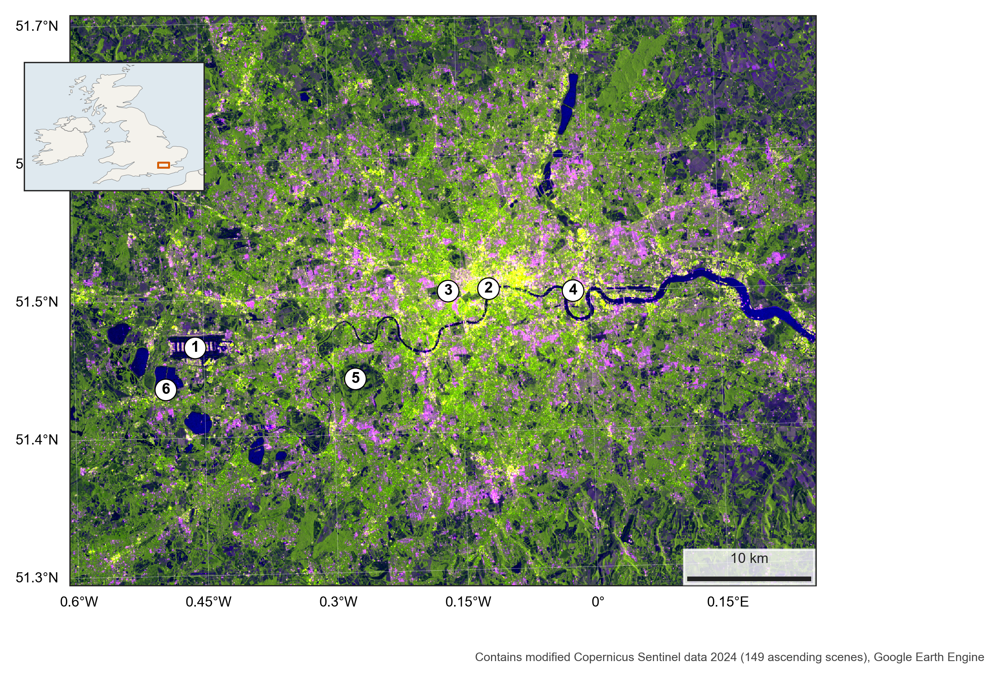

# Reading radar images

A working manual for reading Sentinel-1 radar images, step by step, on real places. LaTeX is the one source for the PDF and the web pages, and every number and map comes from the code here.





## Chapters

1. How to read a radar image: London
2. Mapping a flood: Sindh, 2022

More are planned on forests, urban growth, ships, ice, conflict damage and subsidence.

## Rebuild

```bash
cd src
python 01_london_basics.py
python 02_sindh_flood.py
python 20_manual_inputs.py
cd ../tex
pdflatex main && pdflatex main
```

The Python scripts need an authenticated Earth Engine account, and `research-helpers`. The same exports for the Earth Engine Code Editor are in [earth-engine-code](https://github.com/AhmadAmmar/earth-engine-code/tree/main/scripts/sar).

Each map has a `.map.json` record of its sources and projection.

## Credit

Contains modified Copernicus Sentinel data. JRC Global Surface Water. Code under MIT, and text and maps under CC BY 4.0.
